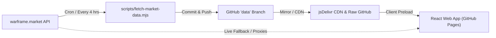

# Loid's Exchange // Arcane Dissolution Market Calculator

[](https://szitku.github.io/loid-vosfor-exchange/)
[](./LICENSE)
[](https://react.dev/)
[](https://vite.dev/)
[](https://tailwindcss.com/)
[](https://github.com/Szitku/loid-vosfor-exchange/actions/workflows/update-market-data.yml)
[](https://github.com/Szitku/loid-vosfor-exchange/actions/workflows/deploy.yml)

> An interactive market valuation terminal for **Warframe's Arcane Dissolution** system (Loid, Sanctum Anatomica, Deimos). Calculate expected Platinum yields per Arcane Pack and maximize your Vosfor efficiency using real transaction statistics from [warframe.market](https://warframe.market).

---

## 🌌 Overview

In *Warframe: Whispers in the Walls*, players can dissolve extra or unwanted Arcanes with **Loid** in the Sanctum Anatomica on Deimos into **Vosfor**. Players then spend **200 Vosfor** to purchase faction-specific Arcane Packs containing **3 random Arcanes**.

Because each pack contains different Arcanes with varied drop weights and volatile market prices, determining which pack yields the highest return on investment in Platinum ($\text{Pt}$) is non-trivial.

**Loid's Exchange** solves this by:
1. Ingesting 48-hour closed transaction data (volume and volume-weighted average prices) from [warframe.market](https://warframe.market).
2. Weighting drop probabilities by rarity tiers and individual collection rules.
3. Calculating the **Expected Value (EV)** per pack and **Platinum per 100 Vosfor** efficiency metric across all available collections.

---

## ✨ Features

- 📈 **Real-Time & Scheduled Market Sync**:
  - Automated GitHub Actions workflow updates market statistics every 4 hours without needing to rebuild or redeploy the frontend.
  - Zero-rate-limit static distribution via raw GitHub and jsDelivr CDN mirrors, with fallback CORS proxy chains for browser resilience.
- ⚖️ **Dual Pricing Strategies**:
  - **Unranked (Rank 0)**: Immediate sell value for players looking to liquidate drops without investing additional Arcanes or Endo/Credits.
  - **Max Rank (Rank 5 / Rank 3 normalized)**: Investment potential for players who rank up Arcanes prior to trading.
- 🧮 **Vosfor Stash Calculator**:
  - Enter your available Vosfor stockpile to compute exact pack counts, projected gross Platinum yield, and best collection recommendations.
- ♻️ **Dissolve or Sell Advisor**:
  - Switch between Rank 0 and max rank to compare sale prices against the expected return from dissolving extras and buying packs.
  - Choose a target collection or compare all scanned packs; expand a result to see every pack with a positive expected gain.
  - Includes source-specific Vosfor yields, max-rank copy counts (21 at rank 5, 10 at rank 3), search, and a worthwhile-only filter. Missing sales data never triggers a recommendation.
- 🎯 **Selective Arcane Exclusion**:
  - Toggle individual Arcanes on or off. Excluded Arcanes still occur within the drop table mathematically, but contribute zero Platinum to your expected yield (ideal for items you plan to keep or low-liquidity Arcanes you do not wish to sell).
- 🔍 **Deep Arcane Insights Modal**:
  - Click any Arcane card or table row to inspect 48-hour trade volume, weighted average sales prices, rank comparisons, and direct one-click links to active listings on [warframe.market](https://warframe.market).
- 🔊 **Atmospheric Orokin / Tenno UI**:
  - Procedural sound synthesizer using the Web Audio API for interactive tactile feedback (toggleable).
  - High-contrast, theme-accurate faction badges, glowing rarity borders, and responsive design for mobile, tablet, and desktop viewports.

---

## 📦 Supported Collections

The calculator supports all 9 Arcane Dissolution packs available from Loid:

| Collection | Source / Faction | Key Highlights |
| :--- | :--- | :--- |
| **Cavia Collection** | Sanctum Anatomica, Deimos | *Melee Crescendo, Melee Duplicate, Melee Fortification* |
| **Duviri Collection** | The Duviri Paradox | *Arcane Reaper, Primary Exhilarate, Shotgun Roar* |
| **Eidolon Collection** | Plains of Eidolon (Quills / Eidolons) | *Arcane Energize, Arcane Grace, Arcane Barrier* |
| **Holdfasts Collection** | Chrysalith, Zariman Ten Zero | *Molt Augmented, Molt Efficiency, Cascadia Flare* |
| **Hollvania Collection** | Warframe: 1999 (The Hex) | *Arcane Bellicose, Arcane Heavyweight, Arcane Camisole* |
| **Necralisk Collection** | Entrati, Deimos | *Residual & Theorem series, Primary/Secondary Plat* |
| **Ostron Collection** | Cetus, Plains of Eidolon | *Exodia Contagion, Exodia Epidemic, Exodia Force* |
| **Solaris Collection** | Fortuna, Orb Vallis | *Pax Seeker, Pax Charge, Virtuos Shadow* |
| **Steel Path Collection** | Teshin / Honors | *Primary Merciless, Secondary Deadhead, Dexterity* |

---

## 📐 Mathematical Model

Each Arcane Pack costs **200 Vosfor** and yields **3 Arcanes**.

### 1. Single Arcane Expected Value ($E[\text{Arcane}]$)

For any collection, each Arcane $i$ has a drop probability $P_i$ derived from its rarity tier and the collection's weighting rules:

$$E[\text{Arcane}] = \sum_{i \in \text{Included}} P_i \times \text{Price}_i$$

> **Note on Exclusions**: When an Arcane is toggled off, it is removed from the summation while preserving the original drop probabilities $P_i$ for all other Arcanes. This accurately mirrors in-game RNG: excluding an Arcane from your trade plan does not boost the drop rate of the remaining items.

### 2. Expected Value per Pack

$$\text{Pack Value} = 3 \times E[\text{Arcane}]$$

### 3. Vosfor Efficiency (Platinum per 100 Vosfor)

Since one pack costs 200 Vosfor:

$$\text{Plat / 100 Vosfor} = \frac{\text{Pack Value}}{2} = 1.5 \times E[\text{Arcane}]$$

### 4. Dissolve or Sell

For an owned Arcane, the advisor compares its **whole-item sale price at the selected rank** against:

$$\text{Dissolution Return} = \frac{\text{Rank 0 Vosfor Yield} \times \text{Copies in Owned Arcane}}{200} \times \text{Pack Value}$$

An Arcane is worth dissolving for a pack only when this expected return exceeds its sale price. Rank 0 uses one copy; max rank uses 21 copies at rank 5 or 10 at rank 3 (unrank before dissolving). Vosfor yields are source-specific, with exceptions such as Pax Arcanes; see the [yield reference](https://wiki.warframe.com/w/Vosfor).

Pack values follow the global selling strategy and exclusions. Max-rank **pack drops** are normalized per copy, while the owned max-rank Arcane's sale price is **not** divided by its copy count. Missing sales do not imply a zero-value owned Arcane and never produce a recommendation.

Fractional packs express the long-run value of pooled Vosfor. Actual purchases require full packs plus 50,000 Credits each; Credit costs, trading time and RNG risk are not converted to Platinum. Comparisons cover only scanned collections and are estimates, not guaranteed profits.

---

## 🏗️ Architecture & Data Pipeline



1. **Automated Fetcher (`scripts/fetch-market-data.mjs`)**:
   - Queries `https://api.warframe.market/v1/items/{id}/statistics` for every Arcane.
   - Filters down to 48-hour closed trade volume and volume-weighted average price (`wa_price`).
   - Implements exponential backoff, retry loops, and rate limiting (concurrency of 3).
2. **Decoupled Data Branch (`data`)**:
   - The workflow pushes updated JSON directly to the `data` branch.
   - The production website serves data dynamically without triggering a full rebuild.
3. **Resilient Client (`src/util/apiClient.js`)**:
   - Tries jsDelivr CDN and raw GitHub.
   - Falls back to local bundled cache, Vite local development proxy, or public CORS proxies if needed.

---

## 🚀 Getting Started

### Prerequisites

- **Node.js**: `v20.x` or higher
- **npm**: `v10.x` or higher

### Installation

1. Clone the repository:
   ```bash
   git clone https://github.com/Szitku/loid-vosfor-exchange.git
   cd loid-vosfor-exchange
   ```

2. Install dependencies:
   ```bash
   npm install
   ```

### Development

Start the local Vite development server with Hot Module Replacement (HMR):

```bash
npm run dev
```

Open [http://localhost:5173](http://localhost:5173) in your browser. In development mode, API requests to Warframe Market are routed through a built-in proxy in `vite.config.js` to avoid CORS issues.

### Fetching Fresh Market Data Locally

To refresh the static market statistics file (`public/data/market-data.json`) from `warframe.market`:

```bash
npm run fetch-data
```

### Production Build

Create an optimized production build:

```bash
npm run build
```

Preview the production build locally:

```bash
npm run preview
```

### Code Quality & Linting

Run ESLint across the codebase:

```bash
npm run lint
```

---

## 📂 Project Structure

```text
loid-vosfor-exchange/
├── .github/
│   └── workflows/
│       ├── deploy.yml              # Automatic deployment to GitHub Pages
│       └── update-market-data.yml  # Scheduled 4-hour market data fetcher
├── public/
│   └── data/
│       └── market-data.json        # Cached 48-hour market statistics
├── scripts/
│   └── fetch-market-data.mjs       # Headless node crawler for warframe.market
├── src/
│   ├── components/
│   │   ├── icons/                  # Warframe & faction SVG icons
│   │   ├── modals/                 # Arcane detail & trade stats modal
│   │   └── sections/               # UI sections (Hero, Cards, Rules, Calculator)
│   ├── data/
│   ├── hooks/                      # Custom hooks (market analysis, filter state)
│   ├── util/                       # Math models, sound FX, API client
│   ├── App.jsx                     # Root application shell
│   └── main.jsx                    # Application entry point
├── LICENSE                         # MIT License & trademark notice
├── package.json
└── vite.config.js                  # Vite configuration & dev proxy
```

---

## 📜 License

This project is licensed under the **MIT License**. See the [LICENSE](./LICENSE) file for full details.

---

## ⚖️ Legal & Trademarks

- **Warframe** and the **Warframe logo** are registered trademarks of **Digital Extremes Ltd.**
- This application is an unofficial, community-created fan utility and is not affiliated with, endorsed by, or sponsored by **Digital Extremes Ltd.**
- Market data is provided by [warframe.market](https://warframe.market). We are deeply grateful to their team for maintaining open community APIs.
