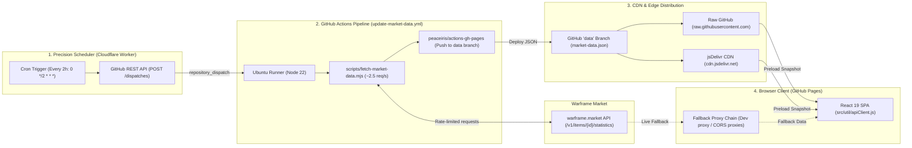

# Loid's Exchange // Arcane Dissolution Market Calculator

[](https://szitku.github.io/loid-vosfor-exchange/)
[](./LICENSE)
[](https://react.dev/)
[](https://vite.dev/)
[](https://tailwindcss.com/)
[](https://workers.cloudflare.com/)
[](https://github.com/Szitku/loid-vosfor-exchange/actions/workflows/update-market-data.yml)
[](https://github.com/Szitku/loid-vosfor-exchange/actions/workflows/deploy.yml)

> An interactive market valuation terminal for **Warframe's Arcane Dissolution** system (Loid, Sanctum Anatomica, Deimos). Calculate expected Platinum yields per Arcane Pack and maximize your Vosfor efficiency using real transaction statistics from [warframe.market](https://warframe.market).

---

## 🌌 Overview

In *Warframe: Whispers in the Walls*, players can dissolve extra or unwanted Arcanes with **Loid** in the Sanctum Anatomica on Deimos into **Vosfor**. Players then spend **200 Vosfor** (and 50,000 Credits) to purchase faction-specific Arcane Packs containing **3 random Arcanes**.

Because each pack contains different Arcanes with varied drop weights and volatile market prices, determining which pack yields the highest return on investment in Platinum ($\text{Pt}$) is non-trivial.

**Loid's Exchange** solves this by:
1. Ingesting 48-hour closed transaction data (volume and volume-weighted average prices) from [warframe.market](https://warframe.market).
2. Weighting drop probabilities by rarity tiers and individual collection rules.
3. Calculating the **Expected Value (EV)** per pack and **Platinum per 100 Vosfor** efficiency metric across all available collections.

---

## ✨ Features

- 📈 **Real-Time & Scheduled Market Sync**:
  - Market statistics update automatically every 2 hours using real 48-hour closed transaction data from [warframe.market](https://warframe.market).
  - Pre-cached market snapshots distributed via CDN mirrors for instant loading without rate limits.
- ⚖️ **Dual Pricing Strategies**:
  - **Unranked (Rank 0)**: Immediate sell value for players looking to liquidate drops without fusing additional duplicate copies.
  - **Max Rank (Rank 5 / Rank 3 normalized)**: Investment potential for players who hold and fuse duplicate Arcanes prior to trading.
- 🧮 **Vosfor Stash Calculator**:
  - Enter your available Vosfor stockpile to compute exact pack counts, projected gross Platinum yield, and best collection recommendations.
- ♻️ **Dissolver**:
  - Switch between Rank 0 and max rank to compare sale prices against the expected return from dissolving extras and buying packs.
  - Choose a target collection or compare against all scanned packs; expand a result to see every pack with a positive expected gain.
  - Independent strategy selectors for **Owned Arcane Rank** (Rank 0 vs. Max Rank) and **Target Pack Drop Strategy** (Unranked vs. Max Rank).
  - Includes source-specific Vosfor yields, max-rank copy counts (21 at rank 5, 10 at rank 3), search, and a worthwhile-only filter. Missing sales data never triggers a false recommendation.
  - Accessible pagination (10 arcanes per page with semantic ellipsis navigation and quick jumping) to swiftly inspect and sort through dozens of candidate arcanes.
- 🎯 **Selective Arcane Exclusion**:
  - Toggle individual Arcanes on or off. Excluded Arcanes still occur within the drop table mathematically, but contribute zero Platinum to your expected yield (ideal for items you plan to keep or low-liquidity Arcanes you do not wish to sell).
- 🔍 **Interactive Exploration, Sorting & Filtering**:
  - Multi-column sorting in collection detail: sort by **Weighted Value**, **48h Volume**, **Average Price**, **Drop Weight**, or **Alphabetical** order with asc/desc toggles.
  - Rarity filtering (**All**, **Common**, **Uncommon**, **Rare**, **Legendary**) and real-time text search with instant clearing.
  - Global collection toolbar search across faction, location, and collection tags.
  - One-click **"Compare all collections"** to batch-fetch and evaluate all 9 packs at once.
- 🔗 **Direct Market Insights & Deep Linking**:
  - Direct one-click links on every Arcane navigate straight to active listings on [warframe.market](https://warframe.market), accompanied by inline 48-hour trade volume, weighted average sales prices, and drop rates.
  - Client-side hash routing (`#/collections` and `#/dissolver`) with instant scroll restoration and URL bookmarking.
- 🔊 **Atmospheric Orokin / Tenno UI**:
  - Procedural sound synthesizer using the Web Audio API for interactive tactile feedback (toggleable).
  - High-contrast, theme-accurate faction badges, glowing rarity borders, and responsive design for mobile, tablet, and desktop viewports.
  - Full keyboard accessibility and "Skip to content" navigation.

---

## 📦 Supported Collections

The calculator supports all 9 Arcane Dissolution packs available from Loid:

| Collection | Source / Faction | Key Highlights |
| :--- | :--- | :--- |
| **Cavia Collection** | Sanctum Anatomica, Deimos | *Melee Crescendo, Melee Duplicate, Melee Fortification* |
| **Duviri Collection** | The Duviri Paradox | *Arcane Reaper, Primary Exhilarate, Shotgun Vendetta* |
| **Eidolon Collection** | Plains of Eidolon (Quills / Eidolons) | *Arcane Energize, Arcane Grace, Arcane Barrier* |
| **Holdfasts Collection** | Chrysalith, Zariman Ten Zero | *Molt Augmented, Molt Efficiency, Cascadia Flare* |
| **Höllvania Collection** | Warframe: 1999 (The Hex) | *Arcane Bellicose, Arcane Camisado, Arcane Escapist* |
| **Necralisk Collection** | Entrati, Deimos | *Residual & Theorem series, Primary Plated Round, Secondary Encumber* |
| **Ostron Collection** | Cetus, Plains of Eidolon | *Exodia Force, Magus Elevate, Virtuos Shadow* |
| **Solaris Collection** | Fortuna, Orb Vallis | *Pax Seeker, Pax Charge, Magus Lockdown* |
| **Steel Path Collection** | Teshin / Honors | *Primary & Secondary Merciless, Deadhead, Dexterity* |

---

## 📐 Mathematical Model

Each Arcane Pack costs **200 Vosfor** and yields **3 Arcanes**.

### 1. Single Arcane Expected Value ($E[\text{Arcane}]$)

For any collection, each Arcane $i$ has a drop probability $P_i$ derived from its rarity tier and the collection's weighting rules:

$$E[\text{Arcane}] = \sum_{i \in \text{Included}} P_i \times \text{Price}_i$$

- **Unranked Strategy**: $\text{Price}_i$ is the volume-weighted average price for Rank 0 sales over 48 hours.
- **Max Rank Strategy**: $\text{Price}_i$ is the volume-weighted average price at max rank divided by the number of copies required to reach max rank (21 copies for Rank 5; 10 copies for Rank 3). This normalizes the investment per drop, representing the normalized per-copy return.

> **Note on Exclusions**: When an Arcane is toggled off, it is removed from the summation while preserving the original drop probabilities $P_i$ for all other Arcanes. This accurately mirrors in-game RNG: excluding an Arcane from your trade plan does not boost the drop rate of the remaining items.

### 2. Expected Value per Pack

$$\text{Pack Value} = 3 \times E[\text{Arcane}]$$

### 3. Vosfor Efficiency (Platinum per 100 Vosfor)

Since one pack costs 200 Vosfor:

$$\text{Plat / 100 Vosfor} = \frac{\text{Pack Value}}{2} = 1.5 \times E[\text{Arcane}]$$

### 4. Dissolver

The Dissolver compares what an Arcane is worth on [warframe.market](https://warframe.market) versus the expected value of dissolving it into Vosfor to purchase new packs:

1. **Sell Value (per copy)**:
   $$\text{Sell / Copy} = \frac{\text{Market Sale Price}}{\text{Copies in Owned Arcane}}$$
   *(Rank 0 = 1 copy; Rank 5 = 21 copies; Rank 3 = 10 copies)*

2. **Dissolution Return (per copy)**:
   $$\text{Dissolve / Copy} = \frac{\text{Vosfor Yield per Copy}}{200} \times \text{Target Pack Value}$$
   *(Equivalently expressed from total yield: $\frac{\text{Total Vosfor Yield}}{\text{Copies in Owned Arcane} \times 200} \times \text{Target Pack Value}$)*

3. **Net Recommendation (Gain per copy)**:
   $$\text{Gain / Copy} = \text{Dissolve / Copy} - \text{Sell / Copy}$$
   - **Gain > 0** $\rightarrow$ **Dissolve**: Dissolving into Vosfor yields more expected Platinum from packs than selling directly.
   - **Gain < 0** $\rightarrow$ **Sell instead**: Selling directly on Warframe Market yields higher return.

4. **Total Yield & Gain**:
   $$\text{Total Expected Return} = \text{Dissolve / Copy} \times \text{Copies in Owned Arcane}$$
   $$\text{Total Net Gain} = \text{Gain / Copy} \times \text{Copies in Owned Arcane}$$

> **Key Notes**:
> - **Per-Copy Normalization**: Comparing everything per Rank 0-equivalent copy ensures an apples-to-apples comparison across unranked and max-rank Arcanes.
> - **Unranking**: Max-rank yields assume unranking at Loid first (21 copies at Rank 5; 10 at Rank 3). Source-specific Vosfor yields follow the official [yield reference](https://wiki.warframe.com/w/Vosfor) (e.g., Pax arcanes yield 36 Vosfor vs. 24 for standard rares).
> - **Drop Selling Strategy**: Target pack returns reflect your chosen drop sale strategy (Rank 0 vs. Max Rank) and account for excluded Arcanes.
> - **Missing Data**: Missing 48-hour sales mean unknown, not zero value (an Arcane with no sales data will never trigger a false recommendation).
> - **Assumptions**: Fractional packs express the expected long-run value of pooled Vosfor. Trading time, market volatility, and the 50,000 Credit cost per pack are not converted to Platinum.

---

## 🏗️ Architecture & Data Pipeline



1. **Precision Scheduler (`worker/src/index.ts`)**:
   - Deployed as a serverless Cloudflare Worker with a Cron Trigger firing every 2 hours (`0 */2 * * *`).
   - Executes with exact second-level precision, completely circumventing GitHub Actions native cron queueing delays or dropped runs during high-traffic GitHub periods.
   - Dispatches a `repository_dispatch` event (`event_type: "update-market-data"`) to the GitHub REST API (`POST /repos/Szitku/loid-vosfor-exchange/dispatches`) in a single subrequest (~200ms runtime).
2. **Automated Ingestion Pipeline (`.github/workflows/update-market-data.yml`)**:
   - Listens for `repository_dispatch` (`types: [update-market-data]`) and manual `workflow_dispatch`.
   - Boots an Ubuntu environment with Node.js 22 and executes `node scripts/fetch-market-data.mjs --force`.
   - Uses `peaceiris/actions-gh-pages@v4` to publish updated market statistics directly to the isolated `data` branch without triggering a redeployment or rebuild of the main application.
3. **Hardened Crawler (`scripts/fetch-market-data.mjs`)**:
   - Iterates through all unique Arcanes across the 9 dissolution collections (~130 items).
   - Implements polite rate-limiting with controlled concurrency (batch size of 2 with a 350ms pause, yielding $\approx 2.5\text{ requests/sec}$) to avoid API rate limits.
   - Robust error handling: exponential backoff on HTTP 429 rate limit responses (up to 4 attempts with progressive backoff delays).
   - Trims raw payloads down to essential 48-hour closed trade statistics (`mod_rank`, `volume`, `wa_price`), producing a compact static JSON file (~300 KB).
   - **Strict Data Integrity**: If any single Arcane fails after all retry attempts, the script aborts immediately with an error, preventing partial or corrupted data from overwriting the last known good snapshot on the `data` branch.
4. **Decoupled Data Branch (`data`)**:
   - Stores only `market-data.json` at the root of the `data` branch.
   - Decoupling data from code eliminates unnecessary production frontend rebuilds and keeps git history clean.
5. **Resilient Client (`src/util/apiClient.js`)**:
   - Upon initial load, the browser preloads `market-data.json` from the `data` branch via raw GitHub and jsDelivr CDN mirrors.
   - In-flight request deduplication prevents duplicate calls for the same Arcane statistics.
   - Multi-tier fallback hierarchy if CDN mirrors are unreachable:
     - Local development Vite proxy (`/api/wf/`) when developing locally.
     - Public CORS proxy chain (`corsproxy.io`, `api.allorigins.win`) for live on-demand fetching in production.
     - Direct API fetch as the final fallback.

---

## 🚀 Getting Started

### Prerequisites

- **Node.js**: `v20.x` or `v22.x` (CI runs on Node 22)
- **npm**: `v10.x` or higher

### Installation

1. Clone the repository:
   ```bash
   git clone https://github.com/Szitku/loid-vosfor-exchange.git
   cd loid-vosfor-exchange
   ```

2. Install dependencies:
   ```bash
   npm install
   ```

### Development

Start the local Vite development server with Hot Module Replacement (HMR):

```bash
npm run dev
```

Open [http://localhost:5173](http://localhost:5173) in your browser. In development mode, API requests to Warframe Market are routed through a built-in proxy in `vite.config.js` to avoid CORS issues.

### Automated Tests

Run the mathematical validation and unit test suite via Node's native test runner:

```bash
npm test
# Or directly via Node:
node --test scripts/*.test.mjs
```

Validates rank-normalization calculations, copy divisors (10 vs 21), unknown market handling, and profit gain parity.

### Fetching Fresh Market Data Locally

To refresh the static market statistics file (`public/data/market-data.json`) directly from `warframe.market`:

```bash
npm run fetch-data
```

### Precision Scheduler (Cloudflare Worker)

The market update scheduler is powered by Cloudflare Workers in `worker/`:

1. Run the worker locally with Wrangler:
   ```bash
   npm run worker:dev
   ```

2. Deploy the worker to Cloudflare:
   ```bash
   npm run worker:deploy
   ```

3. **Required Secrets**: Configure `GITHUB_TOKEN` (a GitHub Personal Access Token with `repo` dispatch permissions) in your Cloudflare Worker environment:
   ```bash
   cd worker
   npx wrangler secret put GITHUB_TOKEN
   ```

### Production Build

Create an optimized production build:

```bash
npm run build
```

Preview the production build locally:

```bash
npm run preview
```

### Code Quality & Linting

Run ESLint across the codebase:

```bash
npm run lint
```

---

## 📂 Project Structure

```text
loid-vosfor-exchange/
├── .github/
│   └── workflows/
│       ├── deploy.yml                          # Automatic deployment to GitHub Pages on push to main
│       └── update-market-data.yml              # Market data fetcher dispatched via repository_dispatch
├── public/
│   ├── data/                                   # [Generated in CI / 'data' branch] Cached market statistics
│   └── favicon.svg                             # Lotus emblem SVG favicon
├── scripts/
│   ├── calculate-dissolution-values.test.mjs   # Unit tests for math models & normalization
│   └── fetch-market-data.mjs                   # Headless rate-limited node crawler for warframe.market
├── src/
│   ├── assets/
│   │   └── fonts/                              # Self-hosted WOFF2 fonts (Cinzel, Cormorant, Rajdhani, Inter)
│   ├── components/
│   │   ├── icons/                              # Warframe & faction SVG icons
│   │   └── sections/                           # UI sections (Hero, Cards, Dissolver, Calculator, Toolbar)
│   ├── data/
│   │   ├── arcanes/                            # 9 Arcane drop tables, Vosfor yields, rarity enums
│   │   └── tilesData.js                        # Collection card definitions, themes & icons
│   ├── hooks/                                  # Custom hooks (market analysis, filter & transition state)
│   ├── types/
│   │   └── dissolution.d.ts                    # TypeScript definitions for packs & calculations
│   ├── util/                                   # Math models, audio engine, API client
│   ├── App.jsx                                 # Root application shell & hash router
│   ├── fonts.css                               # Font-face declarations for self-hosted typography
│   ├── index.css                               # Tailwind CSS v4 styling, custom scrollbars & theme variables
│   └── main.jsx                                # Application entry point
├── worker/                                     # Cloudflare Worker precision cron scheduler
│   ├── src/
│   │   └── index.ts                            # Cron handler (0 */2 * * *) & GitHub repository_dispatch caller
│   ├── package.json                            # Cloudflare Worker dependencies (Wrangler)
│   ├── tsconfig.json                           # TypeScript configuration for Worker
│   ├── wrangler.jsonc                          # Wrangler configuration & cron triggers
│   └── README.md                               # Worker setup & precision scheduler guide
├── LICENSE                                     # MIT License & trademark notice
├── package.json                                # Project scripts & dependencies
└── vite.config.js                              # Vite configuration, vendor chunking & dev proxy
```

---

## 📜 License

This project is licensed under the **MIT License**. See the [LICENSE](./LICENSE) file for full details.

---

## ⚖️ Legal & Trademarks

- **Warframe** and the **Warframe logo** are registered trademarks of **Digital Extremes Ltd.**
- This application is an unofficial, community-created fan utility and is not affiliated with, endorsed by, or sponsored by **Digital Extremes Ltd.**
- Market data is provided by [warframe.market](https://warframe.market). We are deeply grateful to their team for maintaining open community APIs.
